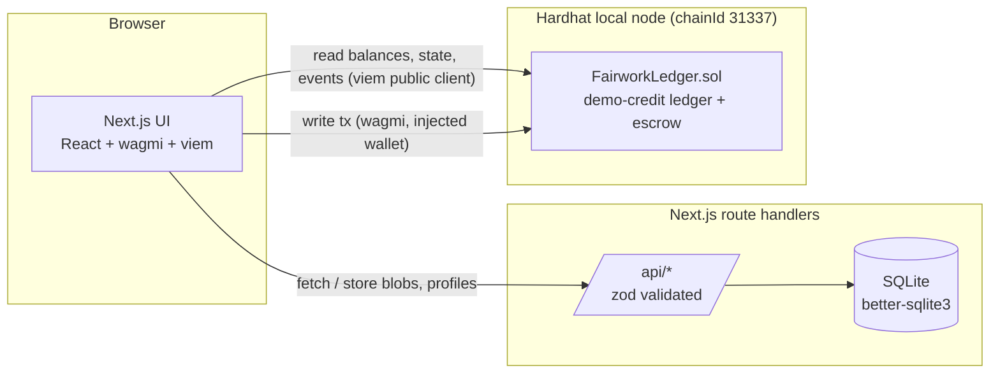
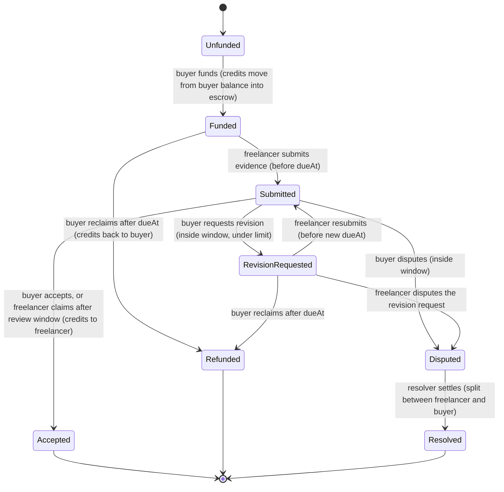

# Fairwork: Specification

> Get paid for what you deliver. Milestone-based freelance agreements with blockchain-enforced accounting.

**Status:** Draft v2 · **Timebox:** 5-6 hours · **Network:** local Hardhat chain only
**Companion doc:** [`plan.md`](./plan.md) (build order, time budget, cut rules). This file is the source of truth for *what* is built and *how it is verified*. If code and spec disagree, fix one of them in the same commit.

---

## 1. Purpose, scope and honesty statement

### 1.1 What this is, and what it is not

Fairwork demonstrates **blockchain-enforced accounting and conditional settlement** for freelance milestones. A Solidity contract keeps a ledger of **demo credits**, locks credits per milestone, and releases, refunds or splits them strictly by contract rules.

| It is | It is not |
|-------|-----------|
| A local-only demo of an on-chain ledger and escrow state machine | Custody of real financial assets |
| Denominated in **demo credits**: integers with no monetary value | ETH, a cryptocurrency, a stablecoin, or an ERC-20 / transferable token |
| Authoritative on chain for every balance and payment state | A payment product: no deposits, no withdrawals to real money, no exchange |
| Initialized with **6,000 demo credits for the demo buyer** | Deployable to a testnet or mainnet (the contract refuses; see 6.1) |

Hard consequences (these are testable, see section 9):
- **No ETH amounts anywhere.** No `payable` functions, no `msg.value`, no `receive`/`fallback`, no real-money withdrawals. The contract never holds ETH.
- **Credits are not a token.** No `transfer`, `approve`, `totalSupply` or `Transfer` event, no ERC-20 interface. Credits move *only* as the result of agreement actions (fund, accept, refund, settle). There is no standalone "send credits to anyone" function.
- **The UI says so.** A persistent footer line reads: "Demo credits are local accounting entries with no monetary value." The funding action repeats it.

### 1.2 Goals
1. A buyer and a freelancer agree on scope, milestones, deadlines, revision limits and credit amounts, and both approve **the same terms** (proved by a hash on chain).
2. Credits for each milestone are locked in the ledger and move **only** by contract rules: accept, timeout, refund or resolver settlement.
3. Every state change is a verifiable on-chain event that the UI renders as history.
4. A disputed milestone's credits stay locked until a pre-agreed resolver settles it (full or partial). No other milestone is ever affected.
5. The UI is small, legible and honest: it shows exactly what the chain says.

### 1.3 Non-goals (do not build, even if time remains)
- Marketplace search, discovery, ranking, messaging, notifications.
- Any real currency, ETH, ERC-20, token standard, faucet, deposit or withdrawal flow.
- Free transfers of credits between accounts, tips (they would require one), and any minting after deployment.
- Testnet or mainnet deployment (the contract is local-only by construction).
- Upgradeable contracts, admin keys, platform fees, pausing.
- Mutual cancellation of an active agreement and mid-flight scope amendments (create a new agreement instead).
- Resolver reputation, staking or timeouts (documented as a known risk).
- Production auth. Identity is the connected wallet address.

---

## 2. Requirements and traceability

Scope tiers decide what is cut first: **A** = needed for the demo, **B** = valuable but trimmable, **C** = stretch. The flows that must work end to end:
- **Golden path (GP):** propose → approve → fund → submit → (revision → resubmit) → accept.
- **Dispute path (DP):** fund → submit → dispute → resolver settles (partial split) with isolation of other milestones.

| # | Feature | Tier | Acceptance criteria (testable) | Verified by |
|---|---------|------|-------------------------------|-------------|
| F1 | Freelancer storefronts | A (minimal) | `/f/[handle]` renders portfolio, ≥2 packages with price in credits and delivery estimate, and a custom commission form. 3 seeded profiles. Shareable URL, no wallet needed to view. | Manual E2E |
| F2 | Agreements and milestones | A | Proposer creates agreement; counterparty sees identical terms and approves. On-chain `termsHash` equals hash of displayed terms. Progress and per-milestone payment state match chain. | T2, T4, hash unit test, E2E |
| F3 | On-chain credit escrow | A | Buyer starts with 6,000 credits (read from chain). Fund locks exactly the milestone credits; accept releases to the freelancer; refund returns to the buyer. Conservation holds after every transaction. No ETH is used. | T1, T3, T4, T9, E2E |
| F4 | Deliverables and revisions | A | Freelancer submits an evidence hash; buyer accepts or requests revision with a reason (hash on chain, text off chain). Revision limit enforced. Wrong-role calls revert. No milestone is paid twice. | T4, T8, actions unit test |
| F5 | Disputes and settlement | A (core) | Dispute locks only that milestone. Only the agreement's resolver settles; full or partial split; `toFreelancer ≤ credits`. Earlier settled milestones unchanged. | T6, T7, E2E DP |
| F6 | Dashboards and history | B | One `/dashboard` page with separate **Buyer** and **Freelancer** views: available credits, locked credits, released and refunded credits, milestone deadlines, dispute states. Per-agreement verified event history on the agreement page (an aggregated history on the dashboard is cut-first). | Selector unit tests, E2E |
| Stretch | Advisory AI assessment, reviews | C | Only after F1-F6 pass. AI is advisory text only and never signs a transaction. | n/a |

---

## 3. Architecture

### 3.1 Principle: chain holds balances and state, database holds words

| Concern | On chain | Off chain (SQLite) |
|---------|----------|--------------------|
| Credit balances, locked credits, payments, refunds, settlements | **Yes (authoritative)** | Never |
| Milestone status, credits, deadlines, revision counts | **Yes** | Never cached as truth |
| Agreement terms text, deliverables, acceptance criteria | Hash only (`termsHash`) | Full JSON, keyed by hash |
| Evidence (links, notes, file hashes) | `evidenceHash` | Reference payload, keyed by hash |
| Revision / dispute reasons and rationale | Hash in event | Text, keyed by hash |
| Storefront profiles, packages, portfolio, commission requests | No | Yes |
| History | Events are the record | Never duplicated |

Off-chain blobs are **content-addressed**: stored under `keccak256(canonical bytes)`. A blob only counts when its hash matches what the chain recorded. The UI recomputes the hash on read and shows **Verified** or **Hash mismatch**. This removes the need for server-side auth on blob writes.

### 3.2 Component diagram



### 3.3 Trust boundaries
- The contract trusts nobody: every function checks the caller's role and the milestone state.
- The resolver is trusted **only** within one agreement: chosen up front, approved by both parties via the terms hash, never either party, and limited to splitting one disputed milestone.
- The server is untrusted for balances and state. It cannot move credits and the UI never trusts its content without a hash check.
- The optional AI assessor is advisory text with no key and no transaction.

### 3.4 Milestone state machine (mirrors the contract)



Terminal states (`Accepted`, `Refunded`, `Resolved`) are absorbing.

### 3.5 Payment state shown in the UI (derived from milestone fields, never stored separately)

| Milestone status | Payment state label | Credits location |
|------------------|--------------------|------------------|
| Unfunded | Not funded | Buyer's available balance |
| Funded, Submitted, RevisionRequested | Locked in escrow | Escrow |
| Disputed | Locked: in dispute | Escrow |
| Accepted | Released | `paidToFreelancer = credits` |
| Resolved | Settled | `paidToFreelancer` + `refundedToBuyer = credits` |
| Refunded | Refunded | `refundedToBuyer = credits` |

---

## 4. Tech stack, dependencies and setup (single chosen configuration)

Pin exact versions with `npm install --save-exact`; commit the lockfile; do not upgrade mid-build. Verify current compatible releases when scaffolding.

| Layer | Choice | Notes |
|-------|--------|-------|
| Runtime | **Node 20 LTS** (`.nvmrc`, `engines` in root `package.json`) | One Node version for every workspace |
| Package manager | **npm workspaces** | Workspaces: `chain`, `web` |
| Contract | Solidity `0.8.x`, one pinned patch version, **zero contract dependencies** | No OpenZeppelin: there are no external calls or ETH transfers to guard |
| Chain tooling | **Hardhat 2.x** + `@nomicfoundation/hardhat-toolbox-viem` | CommonJS TypeScript project; Hardhat 3 is out of scope (different config and ESM model) |
| Web | Next.js (latest stable at scaffold, App Router), React, TypeScript `strict` | Route handlers use `export const runtime = "nodejs"`; `better-sqlite3` listed under `serverExternalPackages` in `next.config` |
| Wallet / chain client | wagmi v2 + viem v2 + `@tanstack/react-query` | Hardhat local chain only; `injected` connector; wagmi config `ssr: true`; one viem version for both workspaces |
| Styling | **Tailwind CSS v4** (CSS-first: tokens in an `@theme` block in `globals.css`, no `tailwind.config`) | Tokens defined once (8.4) |
| Fonts | `next/font/google`: Outfit (headings), DM Sans (body), JetBrains Mono (hashes, addresses) | |
| Storage | `better-sqlite3`, raw SQL, no ORM | Fallback if the native build fails: JSON file behind the same `db/` module |
| Validation | `zod` | Every API boundary and the terms schema |
| Tests | Hardhat test runner (chain), Vitest (web) | |
| Tooling | ESLint (web), Prettier (root), `tsc --noEmit` per workspace, `tsx` (web, seed script), `concurrently` + `wait-on` (root, `demo` script) | No solhint, no coverage gate |

Dependency rule: every dependency beyond this table needs a one-line reason in its commit message and passes the "Ask first" rule (section 13).

---

## 5. Repository layout

```
fairwork/
├── spec.md
├── plan.md
├── README.md                      # quickstart, wallet setup, demo script
├── package.json                   # "workspaces": ["chain", "web"]; root scripts (section 10)
├── .nvmrc                         # 20
├── .gitignore
├── .prettierrc
├── chain/                         # Hardhat project root (workspace "chain")
│   ├── package.json
│   ├── hardhat.config.ts
│   ├── tsconfig.json
│   ├── contracts/FairworkLedger.sol
│   ├── test/
│   │   ├── FairworkLedger.test.ts # grouped T1-T9 (may split by describe blocks)
│   │   └── helpers.ts             # fixture, conservation check, time helpers
│   └── scripts/deploy-local.ts    # deploys, grants credits, writes ../web/src/generated/*
└── web/                           # Next.js app (workspace "web")
    ├── package.json
    ├── next.config.ts
    ├── tsconfig.json
    ├── .env.example               # copy to web/.env.local
    ├── scripts/seed.ts            # resets DB, seeds demo profiles
    ├── src/
    │   ├── app/                   # routes (8.1) and app/api/*
    │   ├── components/            # presentational, no chain calls
    │   ├── features/              # storefront, agreement, milestone, dispute, dashboard
    │   ├── lib/
    │   │   ├── chain/             # wagmi config, ledger hooks, event readers
    │   │   ├── terms.ts           # zod schema, canonicalize, hash
    │   │   ├── actions.ts         # availableActions(...) pure
    │   │   ├── selectors.ts       # dashboard aggregates, pure
    │   │   └── db/                # schema.sql, queries
    │   └── generated/             # git-ignored: abi.ts, deployment.json (written by deploy)
    ├── tests/                     # Vitest: terms, actions, selectors
    └── .data/                     # git-ignored: fairwork.db
```

Layering rule: `components` render props; `features` compose hooks and components; `lib` holds pure logic and adapters. `terms`, `actions` and `selectors` never import React or wagmi.

Demo accounts (Hardhat default accounts; the deploy script and seed script both use this table):

| Index | Role | Credits at deploy |
|-------|------|-------------------|
| #0 | Deployer (no role) | 0 |
| #1, #2, #3 | Demo freelancers (one per storefront) | 0 |
| #4 | **Demo buyer** | **6,000** |
| #9 | Demo resolver | 0 |

---

## 6. Smart contract specification: `FairworkLedger`

Single contract, many agreements. Credits are plain unsigned integers in an internal ledger. No owner, no upgrade path, no fees, no ETH, no token interface, no external calls.

### 6.1 Constants, constructor and local-only guard

```
DEMO_BUYER_CREDITS = 6000     MAX_MILESTONES = 5
MIN_REVIEW_WINDOW = 1 hours   MAX_REVIEW_WINDOW = 30 days
LOCAL_CHAIN_ID = 31337

constructor(address demoBuyer)
  - reverts LocalChainOnly if block.chainid != 31337
  - reverts InvalidInput if demoBuyer == address(0)
  - available[demoBuyer] = 6000; totalIssued = 6000
  - emits DemoCreditsGranted(demoBuyer, 6000)
```

This is the **only** place credits are created. `totalIssued` is a constant after deployment (6,000).

### 6.2 Data model

```solidity
enum AgreementStatus { Proposed, Active, Completed, Cancelled }
enum MilestoneStatus { Unfunded, Funded, Submitted, RevisionRequested, Disputed, Accepted, Resolved, Refunded }

struct MilestoneInput { uint128 credits; uint64 deadline; uint8 revisionLimit; }

struct Milestone {
  uint128 credits;          // fixed at proposal
  uint64  deadline;         // original submission deadline (unix s)
  uint64  dueAt;            // current freelancer deadline (starts = deadline)
  uint64  submittedAt;      // 0 until first submission; updated on resubmission
  uint8   revisionLimit;
  uint8   revisionsUsed;
  MilestoneStatus status;
  bytes32 evidenceHash;     // latest submission
  uint128 paidToFreelancer; // set once, at the terminal state
  uint128 refundedToBuyer;  // set once, at the terminal state
}

struct Agreement {
  address buyer; address freelancer; address resolver;
  uint32  reviewWindow;     // seconds: buyer review time AND freelancer revision turnaround
  AgreementStatus status;
  bool buyerApproved; bool freelancerApproved;
  uint8 milestoneCount; uint8 openMilestones;
  bytes32 termsHash;
}
// storage: uint256 totalIssued; mapping(address => uint256) available;
//          mapping(uint256 => Agreement); mapping(uint256 => Milestone[])
```

`paidToFreelancer` and `refundedToBuyer` make payment tracking authoritative on chain, so the UI never reconstructs balances from events.

### 6.3 Functions

| Function | Caller | Preconditions | Effects |
|----------|--------|---------------|---------|
| `propose(buyer, freelancer, resolver, termsHash, reviewWindow, MilestoneInput[])` returns `id` | buyer or freelancer | buyer ≠ freelancer; resolver ∉ {0, buyer, freelancer}; 1 to 5 milestones; each credits > 0; deadlines strictly increasing and in the future; window within limits; `termsHash` ≠ 0 | Creates agreement `Proposed`; proposer auto-approved; emits `AgreementProposed` |
| `approve(id)` | the party who has not approved | `Proposed` | Records approval; both approved → `Active`; emits `AgreementApproved` and `AgreementActivated` |
| `cancelProposal(id)` | buyer or freelancer | `Proposed` | `Cancelled`; emits `AgreementCancelled` |
| `fundMilestone(id, i)` | buyer | `Active`; milestone `Unfunded`; all milestones `< i` terminal; `now < deadline`; `available[buyer] ≥ credits` | `available[buyer] -= credits`; `Funded`; emits `MilestoneFunded` |
| `submitWork(id, i, evidenceHash)` | freelancer | `Funded` or `RevisionRequested`; `now ≤ dueAt`; hash ≠ 0 | `Submitted`; sets `submittedAt`, `evidenceHash`; emits `WorkSubmitted` |
| `acceptWork(id, i)` | buyer | `Submitted` (allowed any time; paying late is fine) | `available[freelancer] += credits`; `paidToFreelancer = credits`; `Accepted`; closes milestone; emits `MilestoneAccepted` |
| `requestRevision(id, i, reasonHash)` | buyer | `Submitted`; `now ≤ submittedAt + reviewWindow`; `revisionsUsed < revisionLimit`; hash ≠ 0 | `RevisionRequested`; `revisionsUsed++`; `dueAt = now + reviewWindow`; emits `RevisionRequested` |
| `claimAfterReviewTimeout(id, i)` | freelancer | `Submitted`; `now > submittedAt + reviewWindow` | Same credit movement as accept; emits `MilestoneAccepted` with `auto = true` |
| `reclaimMissedDeadline(id, i)` | buyer | `Funded` or `RevisionRequested`; `now > dueAt` | `available[buyer] += credits`; `refundedToBuyer = credits`; `Refunded`; emits `MilestoneRefunded` |
| `raiseDispute(id, i, reasonHash)` | buyer when `Submitted` and inside the review window; freelancer when `RevisionRequested` | as stated; hash ≠ 0 | `Disputed`; credits stay locked; emits `DisputeRaised` |
| `resolveDispute(id, i, toFreelancer, rationaleHash)` | the agreement's resolver | `Disputed`; `toFreelancer ≤ credits` | `available[freelancer] += toFreelancer`; `available[buyer] += credits - toFreelancer`; sets both result fields; `Resolved`; emits `DisputeResolved` |
| views: `getAgreement(id)`, `getMilestones(id)`, `agreementCount()`, `availableOf(account)`, `totalIssued()` | any | n/a | n/a |

Any milestone reaching a terminal state decrements `openMilestones`; at zero the agreement becomes `Completed` (emits `AgreementCompleted`).

There is **no** `withdraw`, no `transfer`, no `payable` function. A freelancer's earnings are simply their `available` balance in the ledger.

Design decisions worth knowing:
- **Why can't the buyer dispute or request a revision after the review window?** Otherwise a silent buyer could hold the freelancer's credits indefinitely. After the window the freelancer may claim. This is the "unfair payment withholding" safeguard.
- **Why does the freelancer only dispute a revision request?** A submitted milestone is accepted, revised, disputed by the buyer, or times out. The freelancer's only contestable decision is a revision request they consider unreasonable.
- **Why sequential funding?** It limits the buyer's locked credits to one open milestone and gives the UI a clear "current milestone".
- **Why 1 to 5 milestones?** Smaller UI and tests; enough to show isolation between milestones.
- **Why enforce rules in the contract?** The UI is a convenience. The contract is the product.

### 6.4 Events (indexed fields noted)

```
DemoCreditsGranted(address indexed account, uint256 credits)
AgreementProposed(uint256 indexed id, address indexed buyer, address indexed freelancer, address resolver, bytes32 termsHash)
AgreementApproved(uint256 indexed id, address indexed by)
AgreementActivated(uint256 indexed id)
AgreementCancelled(uint256 indexed id, address indexed by)
AgreementCompleted(uint256 indexed id)
MilestoneFunded(uint256 indexed id, uint256 indexed index, address indexed buyer, uint256 credits)
WorkSubmitted(uint256 indexed id, uint256 indexed index, bytes32 evidenceHash)
RevisionRequested(uint256 indexed id, uint256 indexed index, bytes32 reasonHash, uint8 revisionsUsed)
MilestoneAccepted(uint256 indexed id, uint256 indexed index, address indexed freelancer, uint256 credits, bool auto)
MilestoneRefunded(uint256 indexed id, uint256 indexed index, address indexed buyer, uint256 credits)
DisputeRaised(uint256 indexed id, uint256 indexed index, address indexed by, bytes32 reasonHash)
DisputeResolved(uint256 indexed id, uint256 indexed index, uint256 toFreelancer, uint256 toBuyer, bytes32 rationaleHash)
```

Buyer and freelancer are indexed on `AgreementProposed`, so dashboards fetch "my agreements" with one filtered `getLogs` call per role and need no indexer service.

### 6.5 Custom errors
`LocalChainOnly`, `NotBuyer`, `NotFreelancer`, `NotResolver`, `NotParty`, `InvalidStatus`, `InvalidInput`, `InsufficientCredits`, `OutOfOrder`, `DeadlinePassed`, `WindowExpired`, `WindowOpen`, `RevisionLimitReached`. Custom errors only, no revert strings.

### 6.6 Invariants (hold after every transaction)

| ID | Invariant |
|----|-----------|
| I1 | **Conservation:** `totalIssued (6000) == Σ available[a] over all accounts + Σ credits of milestones in {Funded, Submitted, RevisionRequested, Disputed}`. Credits are never created or destroyed after the constructor. |
| I2 | A milestone's credits leave escrow exactly once. Terminal states are absorbing. |
| I3 | At a terminal state `paidToFreelancer + refundedToBuyer == credits` (Accepted: paid = credits; Refunded: refunded = credits). |
| I4 | Actions on milestone `i` never change the state, credits or results of any other milestone. |
| I5 | Only `resolveDispute` moves `Disputed` credits, and only the agreement's resolver can call it. |
| I6 | `revisionsUsed ≤ revisionLimit`. |
| I7 | The resolver is never the buyer or freelancer of the same agreement. |
| I8 | The contract has no payable entry point and holds zero ETH. |

### 6.7 Safety checklist
- Checks-Effects-Interactions is trivially satisfied: there are **no external calls and no ETH transfers**, so reentrancy does not apply by construction.
- No `payable`, `receive`, `fallback`, `msg.value`, `tx.origin`, `selfdestruct`, `delegatecall`. Verification: `grep -rn "payable\|msg.value\|receive()\|fallback()" chain/contracts` returns nothing.
- Overflow is checked by Solidity 0.8; loops are bounded (≤ 5 milestones).
- Time uses `block.timestamp` with windows of at least an hour; note the skew tolerance in a NatSpec comment.
- NatSpec on every external function; each state-changing function emits one primary event.

---

## 7. Off-chain data and API

### 7.1 Terms JSON (hashed, stored by hash)

```jsonc
{
  "version": 1,
  "chainId": 31337,
  "unit": "demo-credits",
  "title": "Brand identity for Lumen Coffee",
  "description": "…",
  "buyer": "0x…", "freelancer": "0x…", "resolver": "0x…",
  "reviewWindowSeconds": 259200,
  "milestones": [
    {
      "title": "Logo concepts",
      "deliverables": ["3 logo concepts as SVG"],
      "acceptanceCriteria": ["Concepts are original", "Delivered as vector files"],
      "credits": 500,
      "deadline": 1760000000,
      "revisionLimit": 2
    }
  ],
  "nonce": "random-16-bytes-hex"
}
```

- `credits` is a positive integer (zod: `int().positive().max(6000)`); converted to `bigint` at the contract boundary. Values read from the chain are `bigint`.
- **Canonicalization:** recursively sort object keys, `JSON.stringify` with no whitespace, UTF-8 bytes, `keccak256` (viem).
- **Verification on the agreement page:** recompute the hash from the fetched JSON and compare to `termsHash`; compare each milestone's `credits`, `deadline` and `revisionLimit`, the three addresses and `reviewWindow` against chain values. Any mismatch shows a blocking warning and disables Approve and Fund.

### 7.2 SQLite schema

```
freelancers(handle PK, address, name, headline, bio)
portfolio_items(id PK, handle FK, title, description, tag)
packages(id PK, handle FK, name, description, price_credits, delivery_days, revisions)
commission_requests(id PK, handle FK, requester_address, title, description, budget_credits, created_at)  -- unverified inbox
blobs(hash PK, kind, json, created_at)   -- kind: terms | evidence | reason | rationale
```

`npm run seed` is **destructive**: it drops and recreates all tables. Run it with a fresh chain (agreement ids restart at 1 on a fresh node).

### 7.3 API (route handlers, zod-validated, JSON)

| Route | Purpose |
|-------|---------|
| `GET /api/freelancers`, `GET /api/freelancers/[handle]` | Demo storefront data (read only) |
| `POST /api/commission-requests`, `GET /api/commission-requests?handle=` | Custom commission inbox (unsigned, labelled unverified) |
| `PUT /api/blobs` body `{kind, json}` | Server canonicalizes, hashes, stores, returns `{hash}`. Idempotent. |
| `GET /api/blobs/[hash]` | Returns stored JSON; the client re-verifies the hash |
| `POST /api/disputes/[key]/assessment` (stretch) | Advisory AI summary and suggested split. Never writes to chain. |

Errors use one shape: `{ error: { code, message } }`; 4xx for validation; no stack traces.

### 7.4 Evidence format
`{ note, references: [{label, url?, sha256?}] }`. Manual hash or link entry is the baseline. Optional (tier B): the browser computes SHA-256 of a chosen file locally and stores only hash and label; files are never uploaded. The blob is stored by hash and its keccak hash goes on chain as `evidenceHash`.

---

## 8. Frontend specification

### 8.1 Routes (kept to five)

| Route | Content |
|-------|---------|
| `/` | Three demo storefront cards, connect-wallet entry |
| `/f/[handle]` | Header, portfolio grid, packages (credits), commission form, "Start agreement" |
| `/agreements/new` | Terms form (from `?package=<id>`, `?request=<id>`, or blank), live hash preview, submit proposal |
| `/agreements/[id]` | Terms, verification marker, milestone timeline with payment state, action panel, resolver panel, event history |
| `/dashboard` | `?view=buyer` and `?view=freelancer` (view tabs; default from connected role): available, locked, released and refunded credits; agreements; deadlines; disputes |

The resolver acts from `/agreements/[id]` when the connected account is that agreement's resolver.

### 8.2 Action availability (one pure function, unit-tested)

`availableActions(role, agreement, milestone, nowSeconds, availableCredits)` returns allowed actions plus a disabled reason for the rest. It mirrors 6.3. The UI renders only from this function.

| Milestone status | Buyer | Freelancer | Resolver |
|------------------|-------|-----------|----------|
| Unfunded (previous terminal, before deadline) | Fund (disabled with reason if credits are insufficient) | none | none |
| Funded | Reclaim (after `dueAt`) | Submit work (until `dueAt`) | none |
| Submitted | Accept; Request revision and Dispute (inside window; revisions left for the former) | Claim (after window) | none |
| RevisionRequested | Reclaim (after `dueAt`) | Resubmit (until `dueAt`); Dispute | none |
| Disputed | none (locked) | none (locked) | Settle (slider 0-100% mapped to an exact credit split, plus rationale) |
| Accepted / Resolved / Refunded | none | none | none |

Disabled reasons are one line: "Review window ends in 2d 4h", "Revision limit reached: accept or dispute", "Needs 700 credits, you have 450".

### 8.3 Transaction UX rules
- Every write shows four states: *awaiting wallet*, *pending (tx hash)*, *confirmed*, *failed (decoded custom error name)*.
- Disable the button while a transaction is in flight; refetch from chain after the receipt. No optimistic updates of balances or status.
- Wrong network: block actions and show one "Switch to Hardhat Local" control. The wagmi config contains only the local chain.
- Credits display as integers with thousands separators and the word "credits" ("6,000 credits"); no currency symbols, no decimals. Hashes and addresses use monospace, truncated with copy.
- **Dev tools** (only when `NEXT_PUBLIC_DEV_TOOLS=true`): a small "advance time" control using a viem test client against the local RPC (`evm_increaseTime` + mine) to demo timeouts.

### 8.4 Design system (preserved)

**Anti-slop rules (hard):** no gradients anywhere, no pills (nothing with fully rounded ends), no glassmorphism or blur, no decorative emoji, no drop-shadow stacks, no icon-in-colored-circle feature grids, no filler marketing copy. Content is real demo data.

| Token | Value | Use |
|-------|-------|-----|
| `--canvas` | `#FAFAF2` | Page background |
| `--ink` | `#080A05` | Dashboard container background, primary text on light |
| `--lime` | `#A0C82F` | Primary buttons (dark text on lime), success markers, metric highlights on dark |
| `--lime-deep` | `#669E0A` | Large-type accents, borders, icon strokes on light, hover on lime fills |
| `--stone` | `#AAA997` | Secondary text and borders **on dark** |
| `--stone-soft` | `#D9D6AC` | Cards, dividers, subtle borders **on light** |
| `--muted-on-light` *(derived)* | `#5A594B` | Secondary text on light (stone on off-white is only about 2.3:1) |
| `--danger` *(added)* | `#B3412E` | Disputed, failed, destructive |
| `--warning` *(added)* | `#B7791F` | Approaching deadline, review window closing |

`--danger` and `--warning` are the only additions to the supplied palette. Contrast: dark text on `--lime` is about 10:1, `--lime` on `--ink` about 10:1, `--stone` on `--ink` about 8:1. **Never set small text in lime on the light canvas** (about 1.9:1); `--lime-deep` on light is about 3.1:1, so use it for large text, strokes and fills with dark text only.

**Layout:** off-white canvas with generous margins; dashboards sit inside one `--ink` container (radius 8px). Cards on light: `--stone-soft` 1px borders; on dark: `--stone` at low opacity, 1px. Radius scale: 2px tags and inputs, 6px cards and buttons, 8px dashboard container. No other radii.

**Status markers (instead of pills):** an 8px square marker plus a plain text label, or a rectangular tag with 2px radius and 1px border. Status is never color alone.

| Status | Marker |
|--------|--------|
| Unfunded | `--stone` outline only |
| Funded / Submitted / RevisionRequested | `--lime-deep` fill |
| Accepted / Resolved | `--lime` fill |
| Disputed | `--danger` fill |
| Refunded | `--ink` fill |
| Deadline soon | `--warning` fill |

**Typography:** Outfit headings (500-600), DM Sans body (400-500), JetBrains Mono for hashes and addresses. Body 16px at line-height 1.65; headings 1.2; max line length about 68ch; scale 14 / 16 / 20 / 28 / 40.

**Buttons:** primary = lime fill, dark text, 6px radius, 44px min height; secondary = 1px border, transparent; destructive = `--danger` text with border. Focus ring: 2px `--lime-deep` outline, 2px offset, visible on both backgrounds.

**Accessibility floor:** keyboard-reachable actions, visible focus, labelled inputs, text status labels, `prefers-reduced-motion` respected.

**Copy:** plain and specific ("Fund milestone 1: lock 500 credits"). Persistent footer: "Demo credits are local accounting entries with no monetary value."

---

## 9. Verification strategy (scaled to the timebox)

### 9.1 What gets tested
1. **Contract tests (priority).** Hardhat + viem, nine groups (below).
2. **Three small web unit suites (Vitest):** `terms` (hash stable under key order, changes with any field), `actions` (matrix in 8.2), `selectors` (dashboard totals).
3. **Manual end-to-end checklist** on the local chain with three wallets (9.4). No browser-automation suite.

### 9.2 Contract test groups

| ID | Group | Must prove |
|----|-------|-----------|
| T1 | Setup and grant | Constructor grants exactly 6,000 credits to the demo buyer, 0 to everyone else; `totalIssued` is 6,000; plain ETH sent to the contract reverts and its balance stays 0 |
| T2 | Propose / approve / cancel | Valid proposal works; key invalid inputs revert (same party, resolver is a party, zero credits, unsorted or past deadlines, 0 or >5 milestones, zero hash, caller not a party); only the counterparty approves; both approved → `Active`; cancel only while `Proposed`; `termsHash` and inputs read back exactly |
| T3 | Fund (escrow) | Buyer only; sequential; before deadline; insufficient credits reverts; buyer `available` drops by exactly `credits` and the milestone is locked |
| T4 | Golden path | fund → submit → request revision (count, new `dueAt`) → resubmit → accept; exact balances and result fields; second accept reverts; revision limit reached reverts |
| T5 | Timeouts and refunds | Freelancer claim blocked inside the window and allowed after; buyer reclaim blocked before `dueAt` and allowed after; no double payout across claim, accept and reclaim |
| T6 | Dispute and settlement | Correct caller and state only; credits stay locked; resolver can settle full-to-freelancer, full-to-buyer and partial; `toFreelancer > credits` reverts; second resolve reverts; buyer dispute blocked after the window |
| T7 | Isolation | Dispute and settlement of milestone `i` leave earlier settled milestones and later unfunded ones unchanged (I4) |
| T8 | Permissions sweep | Table-driven: each state-changing function called by each unauthorized role reverts with the specific custom error |
| T9 | Conservation | A helper asserts I1 (and I3 for terminal milestones) after **every** transaction in T3-T7 |

### 9.3 Quality gates
- Before merging to `main`: `npm run lint`, `npm run typecheck`, `npm run test` pass.
- Coverage is informational only; run once in the final phase if time remains (`npm exec -w chain -- hardhat coverage`). It is **not** a gate and there is no fuzz suite.
- Credits-only check (final phase): `grep -rn "payable\|msg.value\|receive()\|fallback()" chain/contracts` returns nothing, and `grep -rniE "ether|wei|eth\b" web/src` finds no payment amounts in UI copy or code.

### 9.4 Manual end-to-end checklist (also the demo script, with expected balances)
Accounts: buyer (#4), freelancer (#1), resolver (#9), imported into the wallet. Start: buyer 6,000, everyone else 0.
1. Open `/f/[handle]` with no wallet: portfolio and packages (priced in credits) are visible.
2. Connect the buyer; create an agreement from a package with 3 milestones of 500, 700 and 300 credits (total 1,500). Hash preview is shown.
3. Switch to the freelancer; the agreement page shows **Verified**; approve (status `Active`).
4. **Golden path, milestone 1:** buyer funds 500 (buyer 5,500, locked 500); freelancer submits evidence; buyer requests a revision with a reason; freelancer resubmits; buyer accepts. Freelancer 500, buyer 5,500, locked 0. History lists each event with a tx hash.
5. **Dispute path, milestone 2:** buyer funds 700 (buyer 4,800); freelancer submits; buyer disputes. Credits stay locked and other actions disappear. Resolver settles 70/30: freelancer +490, buyer +210. Freelancer 990, buyer 5,010. Milestone 1 is unchanged.
6. **Timeout (tier B):** milestone 3: buyer funds 300 (buyer 4,710); freelancer submits; advance time past the review window; freelancer claims. Freelancer 1,290, buyer 4,710. Sum 6,000.
7. Dashboard Buyer and Freelancer views show matching available, locked, released and refunded credits and the dispute state.

---

## 10. Commands

Root `package.json` (workspaces `chain` and `web`); every command runs from the repo root:

```bash
npm install                  # installs both workspaces
npm run chain                # hardhat node on :8545 (chainId 31337, automine)
npm run deploy:local         # deploy FairworkLedger, grant 6,000 credits to account #4,
                             #   write web/src/generated/{abi.ts,deployment.json}
npm run seed                 # reset SQLite, seed demo profiles (addresses from the node's accounts)
npm run dev                  # next dev on :3000
npm run demo                 # chain + wait for :8545 + deploy + seed + dev, via concurrently + wait-on

npm run test                 # test:chain && test:web
npm run test:chain           # hardhat test
npm run test:web             # vitest run
npm run lint                 # eslint (web) + prettier --check
npm run typecheck            # tsc --noEmit in chain and web
npm run format               # prettier --write
```

Wiring (root scripts delegate with `-w`): `chain` → `npm run node -w chain`; `deploy:local` → `npm run deploy -w chain` (runs `hardhat run scripts/deploy-local.ts --network localhost`); `seed` → `npm run seed -w web` (`tsx scripts/seed.ts`); `demo` → `concurrently -k "npm run chain" "wait-on tcp:8545 && npm run deploy:local && npm run seed && npm run dev"`.

Environment (`web/.env.example`, copied to `web/.env.local`; never commit real env files):
```
NEXT_PUBLIC_RPC_URL=http://127.0.0.1:8545
NEXT_PUBLIC_DEV_TOOLS=true          # shows the advance-time control
DB_PATH=./.data/fairwork.db         # relative to web/
# stretch only
AI_ASSESSOR_API_KEY=
AI_ASSESSOR_MODEL=
```

Wallet note: import the Hardhat dev accounts (#1, #4, #9) into the wallet from the node's printed keys (well-known local keys, never reuse elsewhere). After restarting the node, reset the wallet account's activity/nonce, or transactions will fail.

---

## 11. Code style

**General:** small functions, one reason to change; names say what, comments say why; no dead code; delete rather than disable; no TODOs without a matching note in `plan.md`.

**TypeScript:** `strict: true`, no `any` (use `unknown` and narrow), no non-null assertions in app code, discriminated unions for status, `bigint` for every value read from or written to the chain, zod parsing at boundaries then trust types inside. Named exports; one component per file; hooks start with `use`. Side effects only in hooks and route handlers.

**Solidity:** pinned pragma, custom errors, explicit visibility, `external` where possible, `constant` for limits (no magic numbers), NatSpec on externals, one primary event per state change, Solidity-style-guide ordering (state, events, errors, functions).

**CSS / Tailwind:** colors only through tokens (no raw hex in components), spacing on a 4px grid, no one-off radii or shadows.

**Formatting:** Prettier (`printWidth 100`); ESLint with `@typescript-eslint` recommended in `web`. Run `npm run lint` before committing.

---

## 12. Git workflow

- **Trunk-based.** `main` is always green (`lint`, `typecheck`, `test`). Short-lived branches `feat/<slice>`, `fix/<thing>`, `docs/<thing>`, merged when the slice's exit criteria in `plan.md` are met.
- **Conventional Commits**, one per logical step: `feat(chain): add resolveDispute`, `test(chain): isolation of settled milestones`, `feat(web): storefront page`, `docs(spec): clarify review window`. Spec changes land *before* the code that depends on them.
- **Tags** at phase ends: `checkpoint-p0` … `checkpoint-p7`, then `v0.1.0`.
- `.gitignore`: `node_modules`, `.next`, `chain/artifacts`, `chain/cache`, `chain/typechain-types`, `chain/coverage`, `web/.data`, `web/src/generated`, `.env*` except `*.env.example`.
- No force-push to `main`. No committed secrets or database files. `git diff --staged` before every commit.

---

## 13. Boundaries and risks

### Always
- Read the relevant spec section before changing a behavior; update the spec in the same change.
- Write the contract test alongside each contract behavior; keep T9 (conservation) in every scenario.
- Enforce rules in the contract; use `availableActions` only to mirror them.
- Treat the chain as the only source of balances and payment state; refetch after receipts.
- Run `npm run lint && npm run typecheck && npm run test` before merging to `main`.
- Keep a runnable demo at every checkpoint.

### Ask first (stop and decide)
- Adding a dependency beyond section 4.
- Changing the contract's state machine, function signatures or events after `checkpoint-p1`.
- Adding anything from the non-goals list.
- Changing Hardhat major version, framework, database or workspace layout.
- Going more than 15 minutes over a phase budget.

### Never
- Introduce ETH, `payable` functions, `msg.value`, withdrawals to real money, a token interface, a standalone credit-transfer function, or any minting after the constructor.
- Deploy to any chain other than local Hardhat (31337) or remove the chain-id guard.
- Describe demo credits as money, a token or an asset in code, UI or docs.
- Commit secrets or `.env` files.
- Add gradients, pills, glassmorphism or decorative emoji.
- Let the server, the AI assessor or any off-chain component move credits or decide a settlement.
- Treat off-chain data as truth without a hash check against the chain.
- Add owner or admin powers or a backdoor to the contract.
- Skip or delete a failing test to get green.
- Edit generated files in `web/src/generated` by hand.

### Known risks (acknowledged, not fixed in scope)
| Risk | Mitigation or acceptance |
|------|--------------------------|
| Resolver never acts and credits stay locked | Accepted for the demo; mitigated by choosing the resolver up front; future: resolver timeout |
| Resolver bias | Resolver is approved by both parties via the terms hash; future: panels |
| Evidence is a reference, not the work | The hash proves what was submitted and when, not its quality |
| Only account #4 holds credits | By design for the demo; the demo buyer is account #4 |
| Wallet or nonce issues after node restart | README note on resetting the wallet account; rehearse; keep a recorded fallback |
| Block timestamp skew | Windows ≥ 1 hour; documented in NatSpec |
| Unsigned commission requests can be spoofed | Labelled unverified; they never move credits |

### Decision log
| ID | Decision | Alternative rejected | Reason |
|----|----------|----------------------|--------|
| D1 | One ledger contract, many agreements | Contract per agreement | Less code and simpler indexing in 6 hours |
| D2 | Internal demo-credit ledger | Native ETH escrow | Demonstrates enforced accounting without custody of real assets |
| D3 | No transfer, no withdraw, no token interface | ERC-20 style credits | Credits must not be a transferable token; movement only via agreement actions |
| D4 | Local-only guard on chain id 31337 | Optional testnet | Keeps the demo-credit model impossible to mistake for a real-asset deployment |
| D5 | Hash on chain, text off chain | Text on chain | Cost and privacy; hash still gives tamper evidence |
| D6 | Either party may propose; the other approves | Buyer-only creation | Supports "buy a package" and "draft for a custom request" |
| D7 | Sequential milestone funding | Fund all at once | One open milestone at a time; clear current milestone |
| D8 | Events as history, no indexer | The Graph or custom indexer | No extra infrastructure; indexed fields make queries cheap |
| D9 | SQLite, raw SQL | Postgres + ORM | Zero setup in the timebox |
| D10 | Hardhat 2.x, `chain/` and `web/` workspaces, Node 20 | Hardhat 3, nested `contracts/` workspace | One compatible, boring setup |
| D11 | No OpenZeppelin, no solhint, no coverage gate | Full hardening stack | No external calls to guard; scope fits 5-6 hours |
